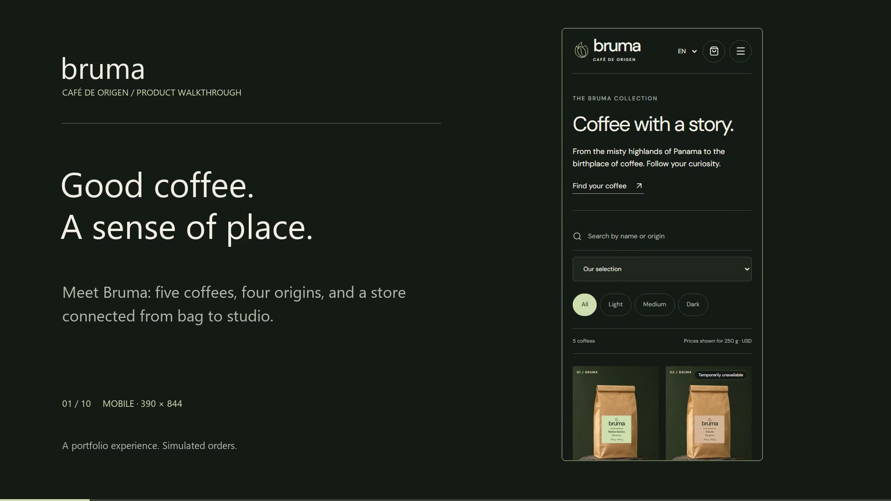

# Bruma Café

A responsive coffee-store portfolio built with React, TypeScript, NestJS and PostgreSQL. Discover five coffees, make a simulated purchase, then follow the same order through a shared store dashboard. English, Spanish and Portuguese; USD throughout.

V3 is published on Vercel, with a NestJS API on Render Free and PostgreSQL on Neon Free. [Deployment details](docs/v3-deployment.md).

[Explore the live demo](https://coffee-shop-app-nine-lilac.vercel.app) · [Watch the walkthrough](https://coffee-shop-app-nine-lilac.vercel.app/walkthrough)

[](https://coffee-shop-app-nine-lilac.vercel.app/walkthrough)

The refreshed V3 walkthrough is a silent, 73-second, 1080p recording of the connected local application: a mobile purchase, the shared dashboard, order preparation and the buyer’s updated receipt, followed by seven seconds of desktop. The player provides English captions, chapters, a transcript and an MP4 download. [Recording and verification notes](docs/walkthrough.md).

## Explore V3

- Two coffees from Panama, one from Brazil, one from Colombia and one from Ethiopia. Choose 250 g or 500 g, whole bean or ground.
- Search by origin, filter by roast, or answer three questions in **Find your coffee** for explained recommendations.
- Apply **BRUMA15** for 15% off coffee. Simulated shipping is USD 5. Checkout offers **Fill demo details** and approved/rejected outcomes.
- The API calculates prices, confirms the order and reserves stock in one transaction. A changed offer returns to review before purchase; retrying an uncertain request cannot create a duplicate order.
- **My orders** keeps the last twenty receipts in the current browser. Receipts show the current backend status. **Order again** reviews current prices and stock before adding items.
- **Brew this coffee** offers measured V60 and French press recipes.
- Open **The studio** in the footer, or `/admin`, and choose **Enter demo account**. No password is needed.
- Explore real demo sales, average order value, trends, leading coffees, recent orders and low-stock alerts over seven or thirty days.
- Edit prices, availability and variant stock for the five fixed coffees. Advance orders from confirmed to preparing, shipped and delivered; cancellation is available before shipping and restores stock once.
- **Reset demo** asks for confirmation and restores the shared sample catalogue, stock and orders for everyone. Restarting the service preserves existing data.

This fictional portfolio store does not process payments or arrange deliveries. The demo account and all commercial data are shared. Checkout names, email addresses and delivery fields stay in the form and are never sent to the API or stored in the database. Guest receipt access is tied to an opaque browser cookie; there are no customer accounts or cross-device recovery. Clearing browser history does not delete the store’s orders. V2 receipts are not imported into V3.

## Run locally

Requires Node.js 24.13 or newer and PostgreSQL. Create separate development and test databases, then copy the examples into ignored files and supply their connection strings and distinct random session secrets of at least 32 characters:

```sh
npm ci
cp apps/api/.env.example apps/api/.env
cp apps/api/.env.test.example apps/api/.env.test
npm run api:build
npm run db:migrate
npm run db:seed
npm run dev
```

Open **http://127.0.0.1:43174**. The development runner starts Vite, the API on port 43175 and a contracts compiler watcher. The sample URLs use a local PostgreSQL instance on port 55437; adjust them to your installation. Seeding initializes only an empty store. Existing local environment files moved to `apps/api/`, including the ignored `.env.deploy` file; their contents are unchanged.

## Verify

```sh
npx playwright install chromium
npm run typecheck
npm run lint
npm run check:architecture
npm run format:check
npm run build:all
npm run test:api
npm test
```

Tests exercise browser journeys and the public HTTP API against real, isolated PostgreSQL. The test runner refuses database URLs outside localhost or whose database name does not end in `_test`, then resets that test database. Run suites sequentially: they share the test API on port 43176. Browser tests use port 43173 and cover three languages, four widths, keyboard use, accessibility, failures, conflicts and connected order recovery.

## Architecture and project records

The npm workspaces form a modular monolith:

```text
apps/
  web/src/
    app/                 Router, layout and composition
    features/            Storefront workflows and admin surfaces
    shared/ui/           Reused visual primitives
    shared/api/          HTTP transport
    i18n/                EN, ES and PT dictionaries
  api/src/
    modules/             Access, catalog, checkout, orders, dashboard, demo, health
    infrastructure/      Database and token-signing primitives
    common/              HTTP errors and traffic budget
packages/contracts/      Shared wire types and order-state vocabulary
tests/
  browser/               Public browser workflows
  api/                   Public HTTP with isolated PostgreSQL
```

Each NestJS feature declares its own module, controllers and providers. Styles live with their owning React feature or UI primitive. Contracts are built before either app; application code imports them through the workspace's public exports. PostgreSQL transactions and the database schema are preserved. The frontend continues to call `/api` on its own origin.

An executable architecture audit checks imports, cycles and provider ownership. [ADR 0001](docs/adr/0001-feature-modules-and-app-workspaces.md) records the responsibilities and trade-offs; the [architecture checkpoint](docs/agents/architecture.md) explains when to revisit them.

- [Approved V3 specification](.scratch/coffee-shop-v3/spec.md) and [delivery tickets](.scratch/coffee-shop-v3/issues/)
- [V3 deployment](docs/v3-deployment.md)
- [Walkthrough production notes](docs/walkthrough.md)
- [Domain glossary](GLOSSARY.md)
- [V2 specification](.scratch/coffee-shop-v2/spec.md) and [original MVP](.scratch/coffee-shop-mvp/spec.md)
- [Original image assets and prompts](docs/assets.md)

The hosting stack is Vercel for the frontend, Render Free for the API and Neon Free for PostgreSQL. `render.yaml` explicitly selects a free API service. Both Vercel and Render follow `main`; the frontend proxies `/api` to `https://bruma-cafe-api.onrender.com`. No secrets belong in Git or the React bundle.
