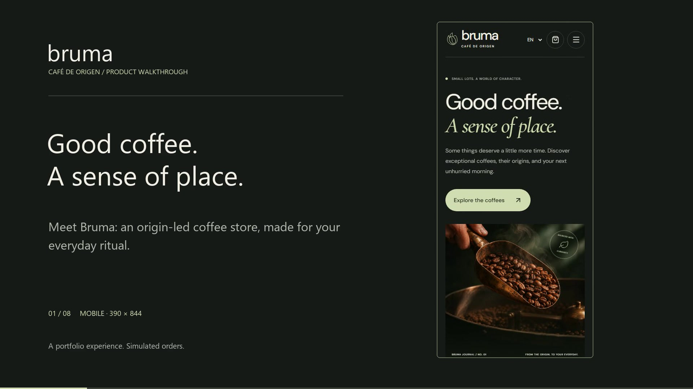

# Bruma Café

A complete, responsive coffee-store portfolio built with React and TypeScript. Five coffees, four origins, three languages, and a carefully simulated checkout.

[Explore the live demo](https://coffee-shop-app-nine-lilac.vercel.app) · [Watch the 72-second walkthrough](https://coffee-shop-app-nine-lilac.vercel.app/walkthrough) · [Download MP4](https://coffee-shop-app-nine-lilac.vercel.app/walkthrough/bruma-walkthrough.mp4)

[](https://coffee-shop-app-nine-lilac.vercel.app/walkthrough)

The silent, 1080p walkthrough follows a complete purchase on a real mobile viewport and ends with a brief desktop view. The player includes chapters, English captions and a transcript. [Recording and verification notes](docs/walkthrough.md).

## Run locally

Requires Node.js 24.13 or newer.

```sh
npm ci
npm run dev
```

Open **http://127.0.0.1:43174**.

## Verify

```sh
npx playwright install chromium
npm run typecheck
npm run lint
npm run format:check
npm run build
npm test
```

Browser tests start an isolated server on port 43173. They cover public user journeys, monetary calculations, persistence, all three languages, four viewport widths, keyboard navigation, and automated accessibility checks.

## Explore the demo

- English, Latin American Spanish and Brazilian Portuguese; USD in every language.
- Two coffees from Panama, one from Brazil, one from Colombia and one from Ethiopia.
- Choose 250 g or 500 g, whole bean or ground. Volcán is intentionally sold out.
- Search by coffee or origin, filter by roast, and compare 250 g prices.
- Group identical variants in the bag, edit quantities (maximum nine) and return later in the same browser.
- Apply **BRUMA15** for 15% off products. Demo shipping is USD 5.
- Use **Fill demo details / Llenar demo / Preencher demo** at checkout.
- Select **Rejected** to test recovery, then **Approved** to complete the demo order.

This is a fictional portfolio brand. No payments, card collection, actual orders or deliveries are involved. Checkout details are not sent to a service.

## Structure and project records

Feature-owned screens, UI and workflow hooks live together. Domain calculations and browser persistence stay outside presentation components. Route composition stays in the application shell.

- [Approved specification](.scratch/coffee-shop-mvp/spec.md)
- [Implementation tickets](.scratch/coffee-shop-mvp/issues/)
- [Domain glossary](GLOSSARY.md)
- [Architecture and verification notes](docs/implementation.md)
- [Original image assets and prompts](docs/assets.md)

For a production preview, run `npm run build` and `npm run preview`. A hosting service must route application URLs to the entry document for client-side navigation.

## Deployment

The demo is hosted on Vercel. `vercel.json` configures the Vite build and direct-entry routing. To publish manually from a linked checkout:

```sh
npx vercel --prod
```

The Vercel GitHub integration is connected to `EPraz/coffee-shop-app`. Pushes to `main` automatically deploy to production. [Publication record](docs/publication-and-walkthrough.md).
